# Calc & Convert

An offline Android calculator and unit converter, combining the original **Calculator** and **UnitConvertorApp** into one app. A dark charcoal interface, orange controls, and two clear tabs keep everyday calculations and conversions together.

## Why I built this

This project brings two Android learning projects together as a useful everyday tool. It explores button input, arithmetic parsing, validation, local history, Android lifecycle state, and conversions that need more than a multiplication factor.

The goal is a small, understandable Kotlin app. The source uses familiar classes, data classes, functions, native Android views, and straightforward event handlers. There is no expression-evaluation SDK, network client, account system, or additional UI framework.

## Features

### Calculator

- Addition, subtraction, multiplication, and division with operator precedence.
- Parentheses, negative numbers, decimals, percent, and integer powers.
- A live result preview, explicit errors, backspace, and clear.
- Cursor editing and selection replacement.
- New number entry after equals, or continued calculation with an operator.
- Up to 30 recent calculations saved locally, with recall and confirmed clearing.
- Copy a result or send it directly to the converter.
- Current calculation restored across activity recreation, including rotation.

### Converter

All 14 requested categories are included; currency is intentionally excluded.

| Category | Examples |
| --- | --- |
| Angle | Degrees, radians, gradians, turns |
| Area | Square metres, square feet, acres, hectares, ares, custom Bigha/Biswa |
| Data | Bits, bytes, decimal kB/MB/GB/TB, binary KiB/MiB/GiB/TiB |
| Energy | Joules, calories, watt-hours, BTU |
| Force | Newtons, pound-force, kilogram-force, dynes |
| Fuel | L/100 km, km/L, US mpg, UK mpg |
| Length | Metric units, inches, feet, yards, miles, nautical miles |
| Power | Watts, mechanical/metric horsepower, BTU/hour |
| Pressure | Pascals, bar, atmospheres, PSI, torr |
| Speed | m/s, km/h, mph, ft/s, knots |
| Temperature | Celsius, Fahrenheit, Kelvin |
| Time | Seconds through weeks, and explicitly defined 365.25-day years |
| Volume | Metric units and clearly labelled US/UK measures |
| Weight | Kilograms, grams, pounds, ounces, stone, US/UK tons |

Drag the category row left/right, or drag the orange slider underneath it to browse from Angle through Weight and back. Browsing does not change the selected category; tap the one you want. Choose a category from the horizontally scrolling strip, enter a value, and select the source and destination units. Results update immediately. Swap reverses the units while keeping your entered value. Copy places the numerical result on the clipboard.

## Real app screenshots

These PNGs are captured from this project's running Android app on an API 37 emulator. They are stored in this repository and embedded below. Example calculations and regional settings are demonstration data.

### Calculator

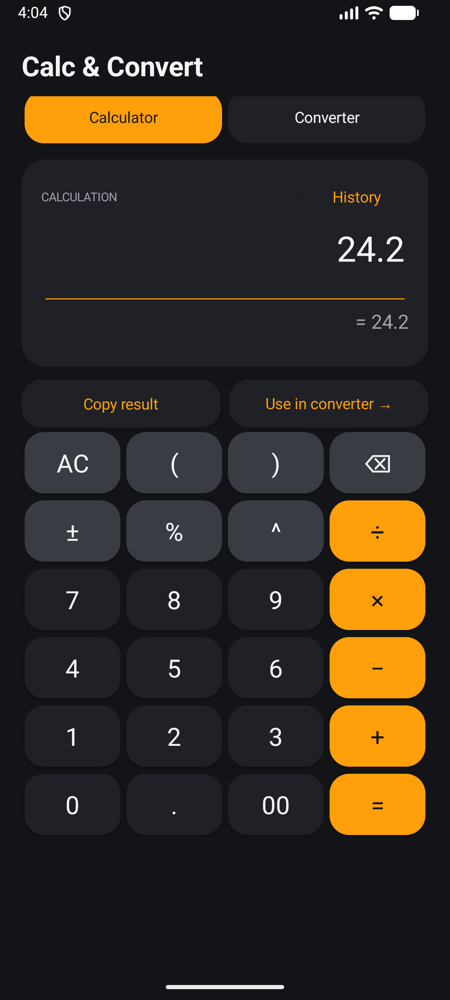

### History

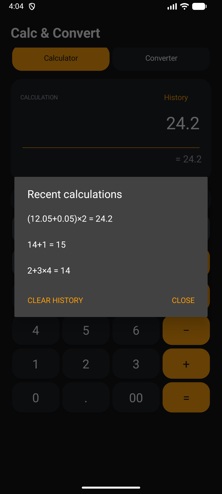

### Angle

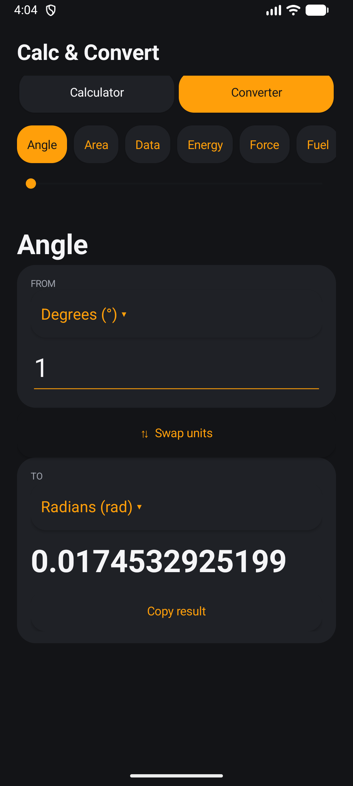

### Area

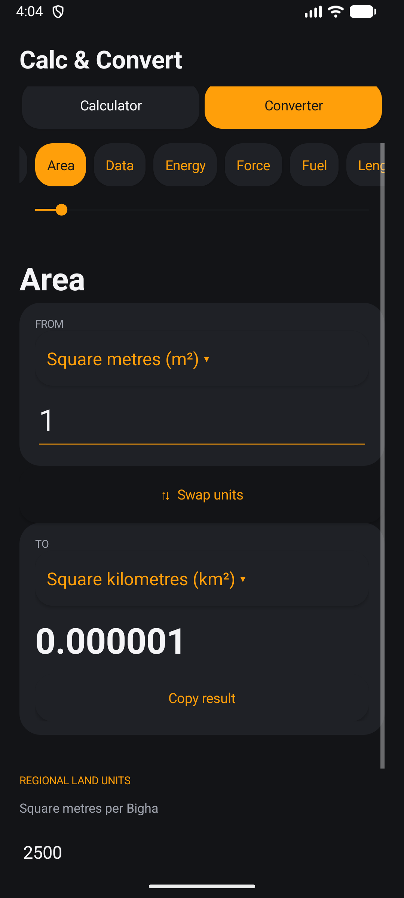

### Regional area settings

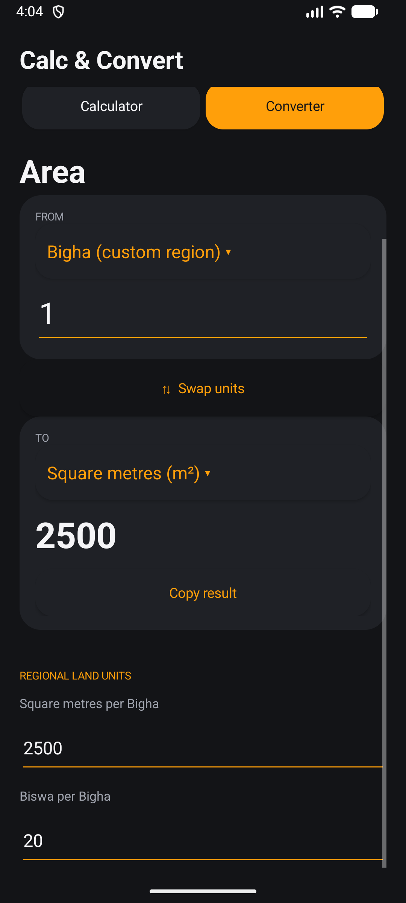

### Data

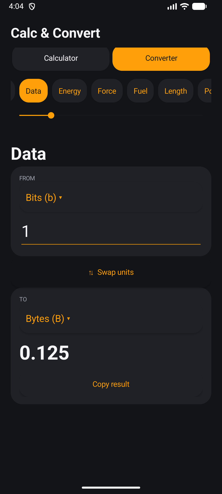

### Energy


### Force

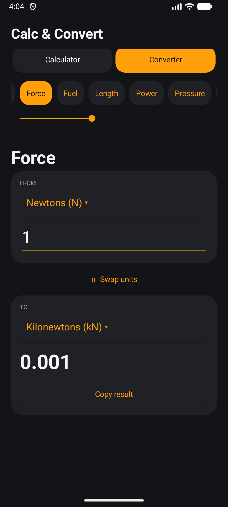

### Fuel


### Length

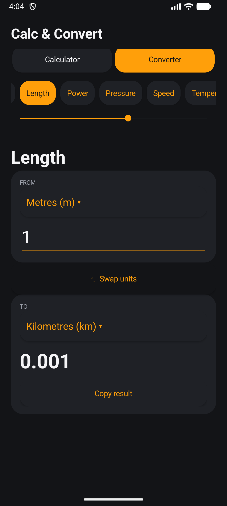

### Power

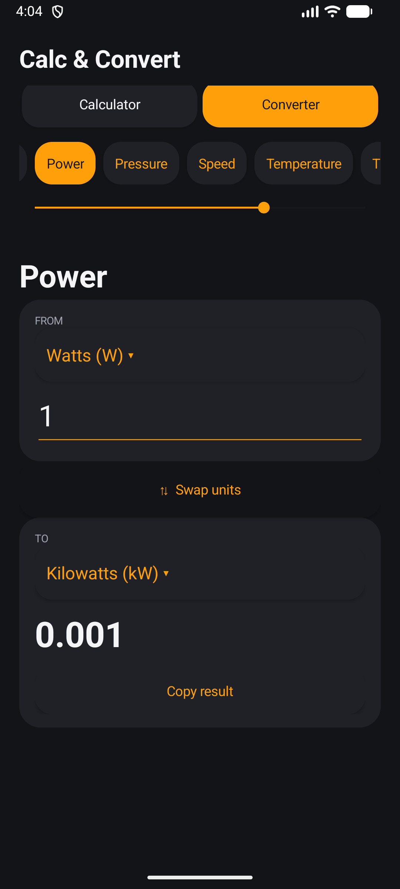

### Pressure

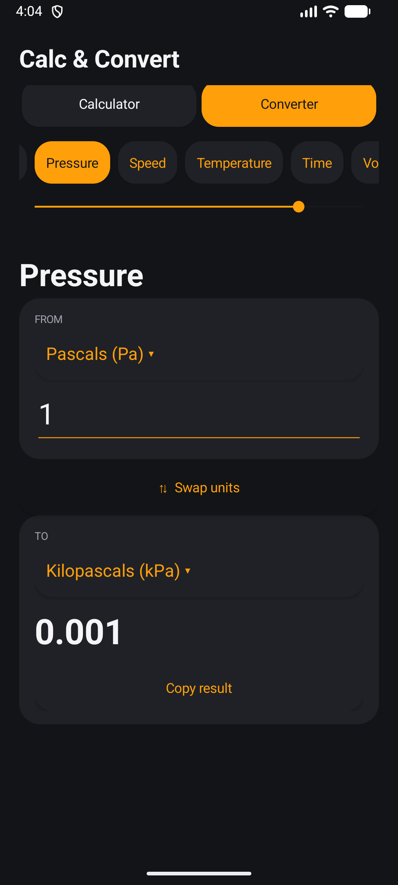

### Speed


### Temperature

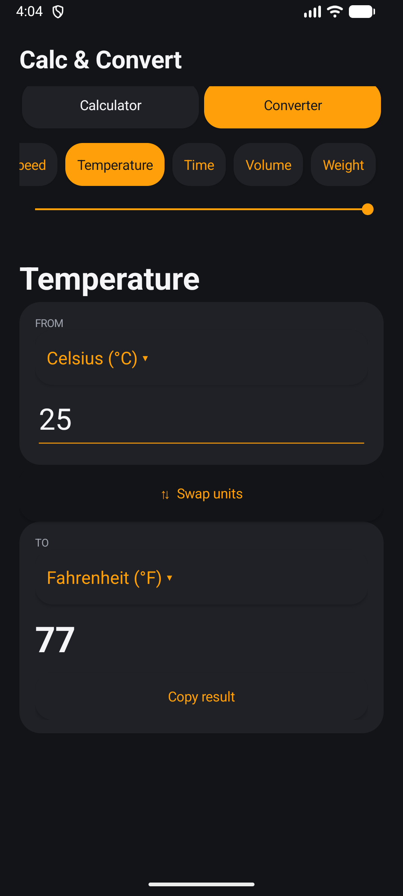

### Time

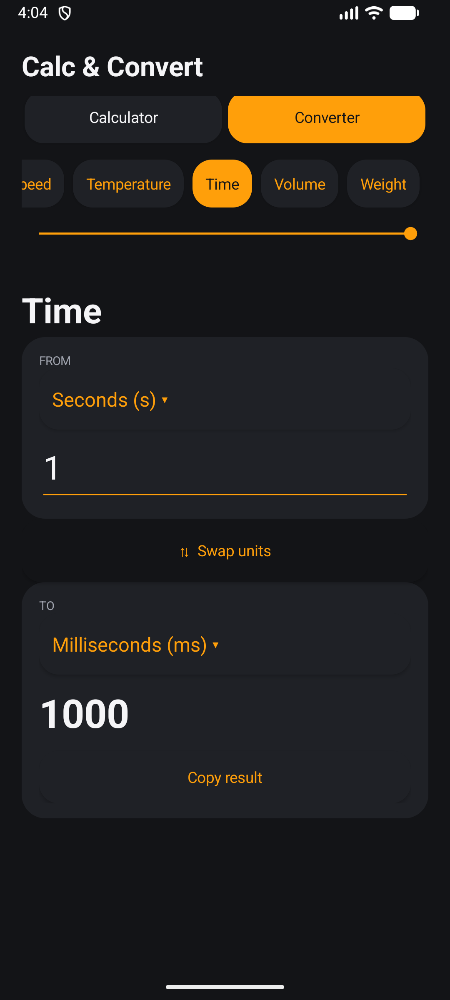

### Volume

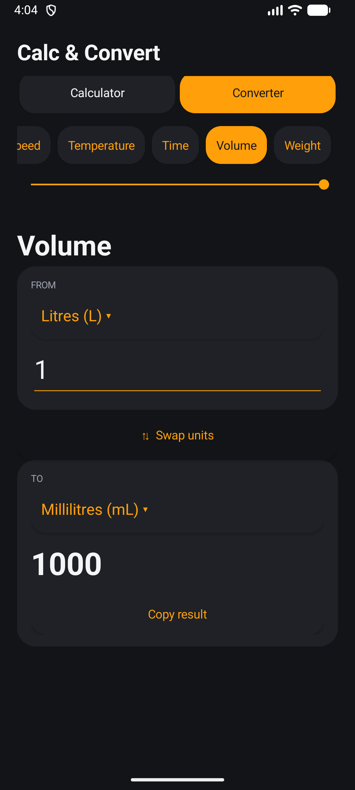

### Weight

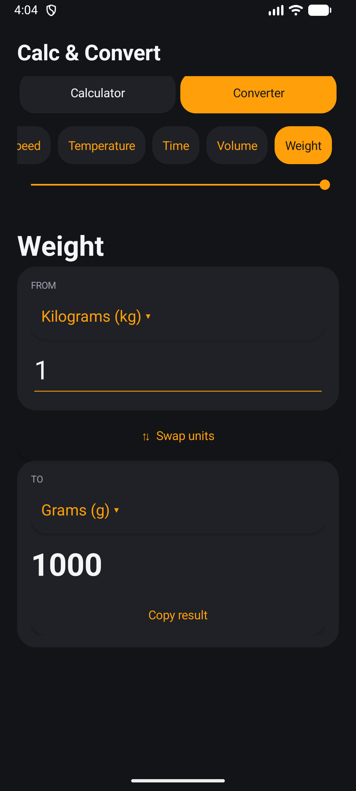

### Unit selection

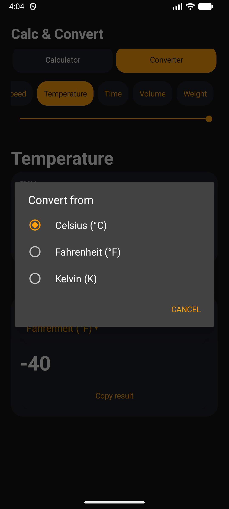

### Validation

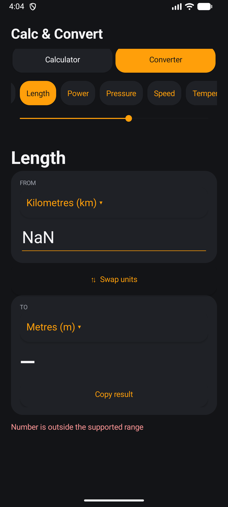

### Landscape layout

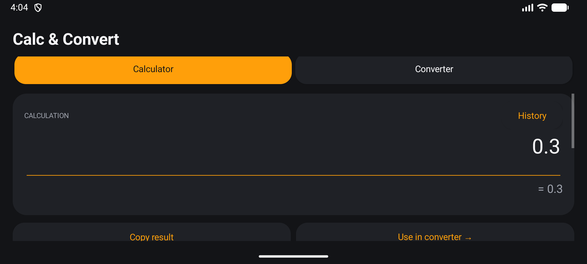

## How to use the calculator

1. Enter a calculation using the keypad. Tap the expression to reposition the cursor.
2. Use parentheses when grouping matters. `2 + 3 × 4` gives `14`; `(2 + 3) × 4` gives `20`.
3. Tap equals to confirm and save a calculation to history.
4. Start typing a digit for a new calculation, or tap an operator to continue from the answer.
5. Tap History to recall a result. Clear history requires confirmation.
6. Use Copy result or Use in converter to reuse an answer.

### Explicit calculation rules

- Percent is a postfix division by 100: `200 × 10% = 20` and `200 + 10% = 200.1`. For a 10% increase, use `200 × (1 + 10%) = 220`. This is not a reproduction of every Apple Calculator behavior.
- The sign button negates the whole expression. For a negative second operand, enter a minus before that operand.
- Powers are right-associative: `2^3^2 = 512`. Exponents must be whole numbers between -100 and 100. `0^0` is rejected.
- Power precedes unary minus: `-2^2 = -4`, while `(-2)^2 = 4`.
- Standard decimal arithmetic uses BigDecimal with 16 significant digits and half-even rounding. Scientific notation is supported by the parser.
- Expressions are limited to 256 characters and 32 levels of nesting. Extreme magnitudes are rejected with a message.
- Repeated equals does not repeat the previous operation. Implicit multiplication such as `2(3)` requires an explicit multiplication sign.

## Conversion rules and regional units

Temperature uses offsets through Kelvin; it does not use ordinary linear scaling. Values below absolute zero are rejected.

Fuel economy is reciprocal. For example, `20 km/L = 5 L/100 km`. Fuel inputs must be greater than zero. US and UK gallons are different and have separate labels.

Data distinguishes decimal and binary prefixes. One byte contains eight bits. Volume distinguishes US and UK gallons and fluid ounces. Horsepower specifies mechanical or metric definitions. Weight converts mass units; force is a separate category.

Bigha and Biswa do not have a universal area. To use them, enter **square metres per Bigha** and, for Biswa, **Biswa per Bigha** for your region in the Area screen. No regional size is assumed. The test values are examples, not a claim about your region. These definitions are saved locally.

Invalid text, nonfinite values, unsupported ranges, and negative physical quantities are rejected instead of silently becoming zero. Angle and temperature support negative values where valid. Inputs use a decimal point; a comma is not treated as a decimal separator. Standard conversion arithmetic uses bounded floating-point factors, with BigDecimal intermediate scaling for linear conversions; displayed results use up to 12 significant digits.

Conversion definitions were checked against [NIST's SI conversion guidance](https://www.nist.gov/pml/special-publication-811/nist-guide-si-appendix-b-conversion-factors), including its [alphabetical conversion table](https://www.nist.gov/pml/special-publication-811/nist-guide-si-appendix-b-conversion-factors/nist-guide-si-appendix-b8). The app labels definition-dependent units explicitly.

## Interface cleanup

The help button/dialog, tagline, explanatory captions, category notes, footer badges, and app-generated clipboard toasts have been removed. Input errors and regional field labels remain so invalid values can be corrected. Calculator, history, copy, result transfer, converters, and the category slider remain available. Calculation rules and unit definitions are documented here instead of inside the interface.

## What changed from the originals

- Combined calculator and conversion functionality under one launcher and two tabs.
- Replaced the old single-operation string splitting with a bounded arithmetic parser.
- Fixed decimal entry, negative-number operations, operator precedence, result formatting, division-by-zero handling, and malformed-input crashes.
- Added parentheses, integer powers, history, clipboard copying, and result transfer.
- Replaced mismatched initial converter factors with one unit catalogue shared by the UI and calculation logic.
- Removed integer-based two-decimal rounding that lost small values and distorted large ones.
- Rejected invalid input instead of treating it as zero.
- Added all 14 categories with special handling for temperature and fuel.
- Preserved regional land conversion through explicit custom definitions.
- Added lifecycle state restoration and a scrollable layout for smaller screens and landscape.
- Removed unused Compose and Material dependencies from this project. Runtime dependencies are AppCompat and Android core only.
- Removed ordinary source/configuration comments; retained third-party Gradle wrapper licence notices and interpreter directives.

The standalone UnitConvertorApp folder remains the original project. The combined implementation is in this Calculator folder. The launcher name is **Calc & Convert**, and the Gradle project name is **CalcAndConvert**. The application ID remains `com.example.calculator`, allowing an update over the old calculator when signing certificates match.

## Code structure

| File | Role |
| --- | --- |
| `MainActivity.kt` | UI, keypad actions, unit selection, saved UI state, and local history. |
| `CalculatorEngine.kt` | Decimal expression parsing, precedence, validation, and formatting. |
| `UnitConverter.kt` | Category/unit definitions, conversion logic, regional factors, and validation. |
| `CalculatorEngineTest.kt` | Arithmetic regression and invalid-expression checks. |
| `UnitConverterTest.kt` | Known conversions, all unit-pair round trips, domains, and range checks. |
| `CombinedAppTest.kt` | Emulator interaction, state restoration, picker/history flows, and screenshots. |
| `scripts/capture_screenshots.py` | Development-only screenshot collection; not part of the Android app runtime. |

No calculator operations use eval, JavaScript, or downloaded code. Arithmetic and conversion logic are separate from the Activity so they can be tested without an emulator.

## Build and run

Requirements: JDK 17, Android SDK Platform 34, Build Tools and Platform Tools, plus an emulator or Android device running API 24 or later.

Open this folder in Android Studio, choose **JDK 17 as the Gradle JDK**, sync, and run `app` on an emulator. A physical phone is not required.

```sh
./gradlew assembleDebug
./gradlew testDebugUnitTest lintDebug
```

The debug APK is created at `app/build/outputs/apk/debug/app-debug.apk`.

```sh
adb install -r app/build/outputs/apk/debug/app-debug.apk
```

Configure your SDK location through your ignored local `local.properties` file. Toolchain: Gradle 8.2, Android Gradle Plugin 8.2.2, Kotlin 1.9.10, compile/target SDK 34, minimum SDK 24.

## Tests and screenshot refresh

The project passed debug assembly, 15 JVM test methods, four emulator tests, and Android lint with warnings. Unit tests include thousands of arithmetic checks and conversion round trips, plus known reference values so inverse errors cannot pass only by cancelling each other.

The emulator tests exercise decimal entry, clear, continued calculation, divide-by-zero errors, history and confirmed clearing, result transfer, unit swapping and selection, invalid values, custom land settings, rotation restoration, landscape, and every conversion category.

With an emulator running:

```sh
./gradlew connectedDebugAndroidTest -Pandroid.testInstrumentationRunnerArguments.class=com.example.calculator.CombinedAppTest
```

Refresh the real UI screenshots with:

```sh
python3 scripts/capture_screenshots.py
```

The helper captures PNGs while instrumentation runs and before test cleanup. The tests temporarily use sample history/settings and restore the prior stored values afterward. Keep unrelated overlays off the emulator while taking screenshots.

## Privacy and publication

The app requests no Internet, location, media, or account permission. It has no API key, ads, analytics, or currency endpoint. Calculation history and regional factors use app-private SharedPreferences. Backups are disabled. Clearing app storage or uninstalling removes them. Clipboard copying happens only when explicitly requested.

History is not an encrypted vault. Do not use it to store passwords or other private credentials. Private device data and generated logs/screenshots should be reviewed before publication.

Ignore rules exclude local SDK paths, environment files, credentials, signing keys, IDE state, and generated output. A browser upload does not apply `.gitignore`; review uploaded files manually. No GitHub push is part of this refinement.

## Limits

The app is English-only with a deliberately dark interface. It does not include currency, trigonometry, logarithms, graphing, live exchange rates, arbitrary-precision scientific computing, or every Apple Calculator interaction. Conversion factors and floating-point precision are appropriate for everyday use, not certified measurement work.

Test success does not establish that every possible bug or dependency vulnerability is absent. The current emulator run does not cover every Android version, hardware keyboard, accessibility setup, locale, storage failure, or font size. Lint warnings include localization and newer available dependency versions. Store release needs current SDK-policy review and release signing.
